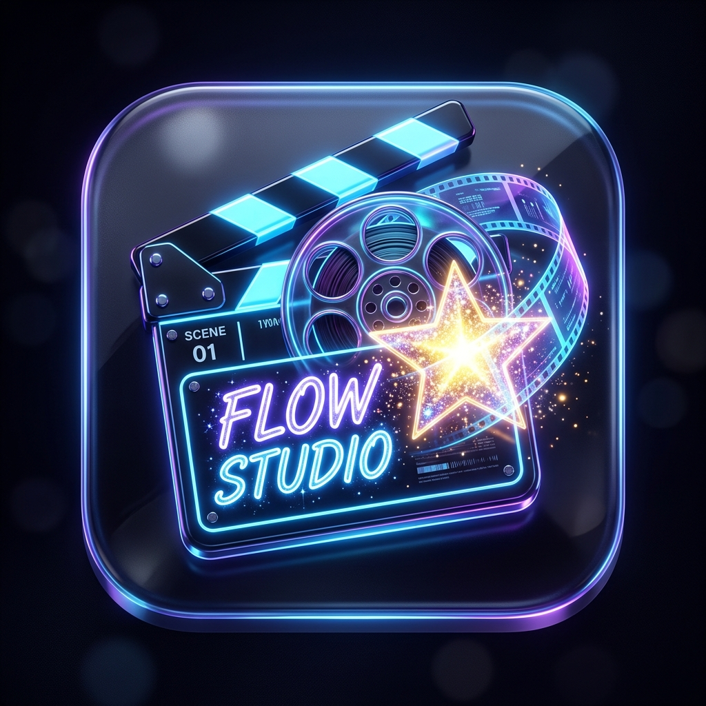
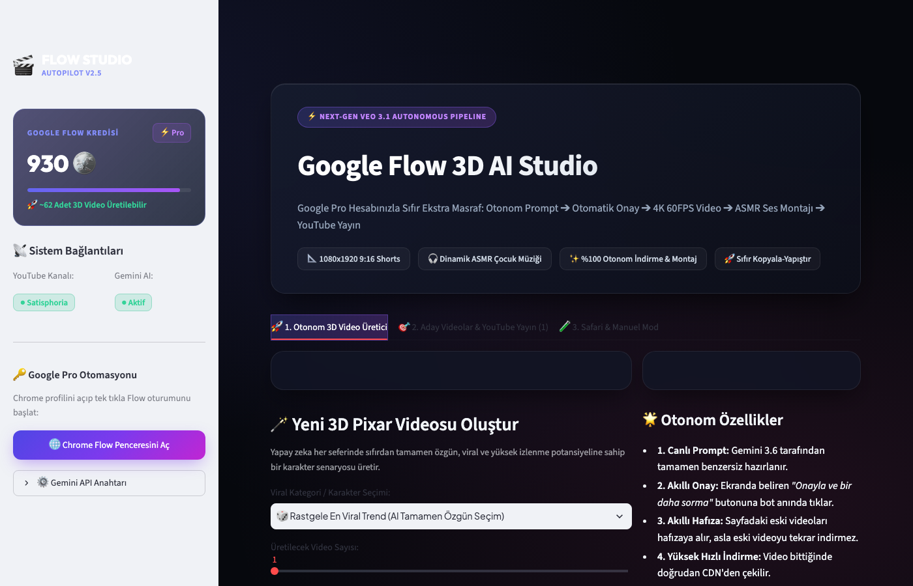
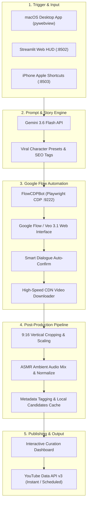

# Flow Studio 🎬 • Autonomous AI 3D Shorts & Veo 3.1 Pipeline

<p align="center">
  
</p>

<p align="center">
  <a href="https://www.python.org/"></a>
  <a href="https://streamlit.io/"></a>
  <a href="https://deepmind.google/technologies/gemini/"></a>
  <a href="https://deepmind.google/technologies/veo/"></a>
  <a href="https://playwright.dev/"></a>
  <a href="https://ffmpeg.org/"></a>
  <a href="https://developers.google.com/youtube/v3"></a>
  <a href="LICENSE"></a>
</p>

<p align="center">
  <strong>End-to-End Autonomous 3D Pixar Animation & Viral Shorts Studio powered by Google Flow, Veo 3.1, Gemini 3.6 & Native macOS App.</strong>
</p>

<p align="center">
  <a href="#-features">Key Features</a> •
  <a href="#-system-architecture">Architecture</a> •
  <a href="#-quickstart--installation">Quickstart</a> •
  <a href="#-macos-native-desktop-app">Desktop App</a> •
  <a href="#-project-structure">Structure</a> •
  <a href="#-license">License</a>
</p>

> 🇹🇷 **Türkçe Dokümantasyon için [README_TR.md](README_TR.md) dosyasına göz atabilirsiniz.**

---

<p align="center">
  
</p>

---

## 🌟 Overview

**Flow Studio** is a next-generation, zero-marginal-cost content creation studio engineered for YouTube Shorts, Instagram Reels, and TikTok. Utilizing your existing Google Pro account via Chrome DevTools Protocol (CDP), Flow Studio automates the entire creative lifecycle:

1. **AI Prompt Engineering:** Gemini 3.6 generates viral character storylines (Pixar-style baby animals, low-stimulation themes, fantasy creatures).
2. **Autonomous Veo 3.1 Generation:** High-fidelity 4K 60FPS video synthesis via Google Flow / VideoFX with automated prompt submission and smart dialog confirmation.
3. **Smart Video Caching & Fast Retrieval:** Automatic memory tracking prevents duplicate downloads; finished videos are fetched directly from CDN.
4. **ASMR Sound Engineering & 9:16 Post-Production:** FFmpeg dynamic scaling, low-stimulation calming audio tracks, and normalization.
5. **Kuration HUD & 1-Click Publishing:** Cyberpunk glassmorphism interface with integrated YouTube Data API v3 scheduler and uploader.
6. **Native Desktop & Mobile Synergy:** Standalone macOS desktop app bundle (`.app`) with custom Retina icon, plus Apple Shortcuts webhook support for remote triggers.

---

## ✨ Features

### 🧠 1. Autonomous Creative Engine (Gemini 3.6 Flash)
- Generates viral prompts tailored for high-retention 9:16 Shorts.
- 11+ built-in character presets (Baby Owl, Hedgehog, Otter, Penguin, Fox, Red Panda, Low Stimulation Bunny, Dragon, Pancake Bear, Elephant).
- Automated SEO metadata generation: Click-worthy titles, emoji-rich descriptions, and viral hashtag sets (`#Shorts #Pixar3D #RelaxingAnimation`).

### 🤖 2. Chrome DevTools Protocol (CDP) Bot
- Connects directly to Google Flow session via remote debugging port `9222`.
- Zero additional API costs: fully leverages your Google Pro subscription and Flow credit pool.
- Automatically handles terms/dialog popups (*"Confirm and do not ask again"*).
- Live credit telemetry: reads real-time balance and visualizes remaining video capacity.

### 🎧 3. Audio & Video Post-Processing Pipeline
- Converts raw landscape video to lossless 1080x1920 9:16 portrait format.
- Mixes royalty-free calming ASMR background tracks with gentle fade-ins and fade-outs.
- Strict frame synchronization and audio normalization for high watch-time algorithms.

### 💻 4. Native macOS Desktop App & Cyberpunk HUD
- Standalone double-clickable `Flow Studio.app` built with Apple Cocoa `pywebview` (WKWebView).
- Custom 3D neon glassmorphism Retina `.icns` app icon (16x16 up to 1024x1024).
- Automatic background Streamlit server lifecycle management and graceful shutdown.
- Dark theme (`#06080D`), responsive glass cards, and neon progress indicators.

### 📤 5. YouTube Data API v3 One-Click Publishing
- Instant publishing or flexible future scheduling.
- Category tagging (`Film & Animation` / `Kids`), custom privacy status (`Public`, `Unlisted`, `Private`).
- Token refresh manager for secure, recurring uploads without re-authentication.

### 📱 6. Apple Shortcuts & Remote Webhook API
- Built-in lightweight HTTP webhook server on port `8503`.
- Trigger autonomous generation from your iPhone via Apple Shortcuts or *"Hey Siri, Flow Studio"*.

---

## 🏛️ System Architecture



---

## 📁 Project Structure

```text
flow-studio/
├── AppIcon.icns                 # High-resolution macOS Retina application icon
├── LICENSE                      # MIT Open-Source License
├── README.md                    # English Documentation
├── README_TR.md                 # Türkçe Dokümantasyon
├── requirements.txt             # Python dependencies
├── run_desktop.py               # macOS Cocoa WKWebView launcher
├── setup_and_run.command        # 1-Click macOS setup & run script
├── start_dashboard.sh           # Terminal dashboard launcher
├── assets/
│   ├── branding/                # Logos, icons, and UI preview assets
│   ├── fonts/                   # High-contrast bold typography
│   ├── music/                   # Calming ASMR loop audio tracks
│   └── sfx/                     # Cartoon & sound effects library
├── config/
│   └── settings.py              # Environment and style configuration
├── dashboard/
│   └── app.py                   # Cyberpunk HUD Streamlit dashboard
├── scripts/
│   └── build_macos_app.sh       # Script to compile native Flow Studio.app bundle
└── src/
    ├── api/
    │   └── shortcuts_server.py  # Apple Shortcuts webhook server (:8503)
    ├── automation/
    │   ├── downloads_watcher.py # Real-time file system download monitor
    │   └── flow_cdp_bot.py      # Playwright Chrome DevTools Protocol automation
    ├── generator/
    │   ├── google_labs_prompter.py # Gemini 3.6 prompt synthesizer
    │   └── prompt_templates.py     # Pixar 3D prompt presets
    ├── media/
    │   └── audio_manager.py     # Sound engineering and volume leveling
    ├── video_engine/
    │   └── video_enhancer.py    # FFmpeg 9:16 rendering and ASMR mix
    └── youtube/
        └── uploader.py          # YouTube Data API v3 automated publisher
```

---

## 🚀 Quickstart & Installation

### Prerequisites
- **Python:** 3.11 or higher
- **FFmpeg:** Installed and available in PATH (`brew install ffmpeg` on macOS)
- **Google Chrome:** Standard installation (for CDP automation)
- **Google Account:** With access to Google Flow / VideoFX

### 1. Clone Repository
```bash
git clone https://github.com/efekkoc/FlowStudio.git
cd FlowStudio
```

### 2. Setup Virtual Environment
```bash
python3 -m venv .venv
source .venv/bin/activate
pip install --upgrade pip
pip install -r requirements.txt
playwright install chromium
```

### 3. Configure Environment Variables
Copy `.env.example` to `.env`:
```bash
cp .env.example .env
```
Fill in your Google Gemini API key:
```env
GEMINI_API_KEY=your_gemini_api_key_here
YOUTUBE_CLIENT_SECRET_FILE=client_secrets.json
```

---

## 🖥️ Running Flow Studio

### Option A: Native macOS Desktop App (Recommended)
Compile the standalone `.app` bundle onto your Desktop:
```bash
chmod +x scripts/build_macos_app.sh
./scripts/build_macos_app.sh
```
Double-click **`Flow Studio.app`** on your Desktop or run:
```bash
python3 run_desktop.py
```

### Option B: Terminal Web Dashboard
```bash
chmod +x start_dashboard.sh
./start_dashboard.sh
```
Navigate to `http://localhost:8502` in your browser.

---

## 🔑 YouTube API Setup (Optional for Auto-Publishing)

1. Open [Google Cloud Console](https://console.cloud.google.com/).
2. Create a project and enable **YouTube Data API v3**.
3. Configure the **OAuth Consent Screen** (User Type: External, add your YouTube channel email as a Test User).
4. Create Credentials: **Create Credentials > OAuth client ID > Desktop App**.
5. Download the credentials file and save it in the root folder as `client_secrets.json`.
6. Run the authentication script once to generate your persistent `token.json`:
   ```bash
   python3 auth_youtube.py
   ```

---

## 🔒 Security & Privacy Notice

- **No Passwords Stored:** Flow Studio connects to your existing browser session via CDP. No Google credentials or passwords are ever captured or saved.
- **Strict Git Exclusions:** `.env`, `client_secrets.json`, `token.json`, and browser user profiles are strictly ignored in `.gitignore`.

---

## 📄 License

This project is open-source under the terms of the [MIT License](LICENSE).

---

## 👨‍💻 Author

Crafted with ❤️ by **Turgut Efekan Koç** ([@efekkoc](https://github.com/efekkoc))
