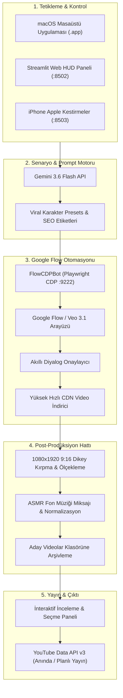

# Flow Studio 🎬 • Otonom Yapay Zeka 3D Shorts & Veo 3.1 Üretim Hattı

<p align="center">
  
</p>

<p align="center">
  <a href="https://www.python.org/"></a>
  <a href="https://streamlit.io/"></a>
  <a href="https://deepmind.google/technologies/gemini/"></a>
  <a href="https://deepmind.google/technologies/veo/"></a>
  <a href="https://playwright.dev/"></a>
  <a href="https://ffmpeg.org/"></a>
  <a href="https://developers.google.com/youtube/v3"></a>
  <a href="LICENSE"></a>
</p>

<p align="center">
  <strong>Google Flow, Veo 3.1, Gemini 3.6 ve Yerel macOS Masaüstü Uygulaması ile Güçlendirilmiş Uçtan Uca Otonom 3D Pixar Animasyon ve Viral Shorts Stüdyosu.</strong>
</p>

<p align="center">
  <a href="#-temel-özellikler">Özellikler</a> •
  <a href="#-sistem-mimarisi">Mimari</a> •
  <a href="#-hızlı-başlangıç--kurulum">Kurulum</a> •
  <a href="#-macos-yerel-masaüstü-uygulaması">Masaüstü Uygulaması</a> •
  <a href="#-proje-dizin-yapısı">Dizin Yapısı</a> •
  <a href="#-lisans">Lisans</a>
</p>

---

<p align="center">
  
</p>

---

## 🌟 Genel Bakış

**Flow Studio**, YouTube Shorts, Instagram Reels ve TikTok platformları için sıfır ek masrafla yüksek izlenme potansiyeline sahip viral içerikler üreten yeni nesil bir yapay zeka stüdyosudur. Google Pro aboneliğinizi Chrome DevTools Protocol (CDP) üzerinden kullanarak tüm yaratıcı süreci %100 otonom hale getirir:

1. **Yapay Zeka Prompt Mühendisliği:** Gemini 3.6 Flash, yüksek izlenme ve tekrar izlenme (loop) oranına sahip 3D karakter senaryoları yazar.
2. **Otonom Veo 3.1 Video Üretimi:** Google Flow / VideoFX üzerinde otomatik metin girişi, akıllı diyalog onaylama ve CDN üzerinden yüksek hızlı video indirme.
3. **Akıllı Hafıza & Önleme:** Sayfadaki eski videoları hafızaya alarak aynı videoyu tekrar indirmez; yalnızca yeni üretilen videoyu çeker.
4. **ASMR Ses Mühendisliği & 9:16 Montaj:** FFmpeg ile 1080x1920 dikey formatlama, düşük uyarım sağlayan sakinleştirici çocuk fon müziği ve ses dengelemesi.
5. **Kürasyon & Tek Tıkla YouTube Yayını:** Siberpunk glassmorphic arayüz üzerinden videoları önizleme, anında yayınlama veya ileri tarihe planlama.
6. **macOS Masaüstü & iPhone Sinerjisi:** Çift tıklanabilir bağımsız macOS `.app` paketi ve Apple Kestirmeler (Shortcuts) uzaktan tetikleme desteği.

---

## ✨ Temel Özellikler

### 🧠 1. Otonom Yaratıcı Motor (Gemini 3.6 Flash)
- US ve global çocuk/animasyon pazarı için optimize edilmiş promptlar.
- 11+ hazır viral karakter şablonu (Bebek Baykuş, Kirpi, Su Samuru, Penguen, Tilki, Kızıl Panda, Düşük Stimülasyonlu Tavşan, Ejderha, Ayıcık, Bebek Fil).
- Tıklanma oranı yüksek başlıklar, emoji zengini açıklamalar ve viral etiket setleri.

### 🤖 2. Chrome DevTools Protocol (CDP) Botu
- Google Flow oturumuna `9222` portu üzerinden doğrudan bağlanır.
- Sıfır ekstra API masrafı: Google Pro aboneliğinizin sunduğu Flow kredilerini kullanır.
- Ekranda beliren *"Onayla ve bir daha sorma"* popup'larını anında tespit edip tıklar.
- Canlı kredi telemetrisi: Kalan krediyi okur ve kaç adet video üretilebileceğini hesaplar.

### 🎧 3. Profesyonel Video & Ses Montaj Hattı
- Yatay gelen videoları kayıpsız 1080x1920 9:16 Shorts formatına çevirir.
- Telifsiz, sakinleştirici ASMR çocuk fon müzikleri miksler (fade-in / fade-out).
- Algoritma dostu ses normalizasyonu uygular.

### 💻 4. Yerel macOS Masaüstü Uygulaması & HUD Panel
- Apple Cocoa `pywebview` (WKWebView) altyapılı, bağımsız `Flow Studio.app`.
- 1024x1024 Retina çözünürlüklü özel 3D neon glassmorphism `.icns` ikonu.
- Arka plandaki Streamlit sunucusunu otomatik açıp kapatan temiz süreç yönetimi.
- macOS Koyu Mod (`#06080D`), kalıcı sol panel ve neon durum göstergeleri.

### 📤 5. YouTube Data API v3 ile Tek Tıkla Yayın
- Anında yükleme veya geleceğe dönük tarih/saat planlama.
- Otomatik kategori seçimi (`Film & Animasyon`), gizlilik durumu kontrolü.
- Token yenileme mekanizması ile tek seferlik giriş sonrası sürekli otomatik yükleme.

---

## 🏛️ Sistem Mimarisi



---

## 🚀 Hızlı Başlangıç & Kurulum

### Gereksinimler
- **Python:** 3.11 veya üzeri
- **FFmpeg:** Sistemde yüklü ve PATH'e ekli (`brew install ffmpeg`)
- **Google Chrome:** Güncel sürüm (CDP otomasyonu için)
- **Google Hesabı:** Google Flow / VideoFX erişimi olan hesap

### 1. Projeyi Klonlayın
```bash
git clone https://github.com/efekkoc/FlowStudio.git
cd FlowStudio
```

### 2. Sanal Ortamı Kurun ve Bağımlılıkları Yükleyin
```bash
python3 -m venv .venv
source .venv/bin/activate
pip install --upgrade pip
pip install -r requirements.txt
playwright install chromium
```

### 3. Çevre Değişkenlerini Ayarlayın
`.env.example` dosyasını `.env` olarak kopyalayın:
```bash
cp .env.example .env
```
Google Gemini API anahtarınızı ekleyin:
```env
GEMINI_API_KEY=senin_gemini_api_anahtarin
YOUTUBE_CLIENT_SECRET_FILE=client_secrets.json
```

---

## 🖥️ Flow Studio'yu Başlatma

### Seçenek A: Yerel macOS Masaüstü Uygulaması (Önerilen)
Masaüstünüze çift tıklanabilir `.app` paketini derleyin:
```bash
chmod +x scripts/build_macos_app.sh
./scripts/build_macos_app.sh
```
Masaüstünüzdeki **`Flow Studio.app`** simgesine çift tıklayın veya terminalden:
```bash
python3 run_desktop.py
```

### Seçenek B: Terminal Web Paneli
```bash
chmod +x start_dashboard.sh
./start_dashboard.sh
```
Tarayıcınızda `http://localhost:8502` adresini açın.

---

## 🔑 YouTube API Kurulumu (Otomatik Yükleme İçin)

1. [Google Cloud Console](https://console.cloud.google.com/)'a gidin.
2. Yeni bir proje oluşturup **YouTube Data API v3** servisini aktif edin.
3. **OAuth Consent Screen** (Dış Kullanıcı) kısmından kanalınızın Gmail adresini Test Kullanıcısı olarak ekleyin.
4. **Kimlik Bilgileri > Kimlik Bilgisi Oluştur > OAuth İstemci Kimliği > Masaüstü Uygulaması** seçin.
5. İndirdiğiniz JSON dosyasını ana dizine `client_secrets.json` adıyla kaydedin.
6. İlk yetkilendirmeyi tamamlamak için bir defaya mahsus çalıştırın:
   ```bash
   python3 auth_youtube.py
   ```

---

## 🔒 Güvenlik & Gizlilik Bildirimi

- **Parola Saklanmaz:** Flow Studio, Google şifrenizi asla kaydetmez veya istemez; mevcut açık Chrome oturumunuza CDP protokolüyle yerel olarak bağlanır.
- **Git Koruması:** `.env`, `client_secrets.json`, `token.json` ve kullanıcı profil verileri `.gitignore` ile korunmaktadır.

---

## 📄 Lisans

Bu proje [MIT Lisansı](LICENSE) kapsamında açık kaynak olarak sunulmuştur.

---

## 👨‍💻 Geliştirici

**Turgut Efekan Koç** ([@efekkoc](https://github.com/efekkoc))
